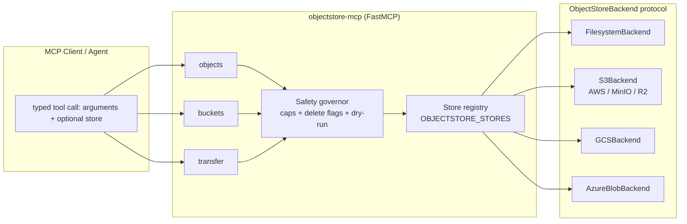

# Architecture

## Layers

| Layer | Module | Responsibility |
|---|---|---|
| Tool surface | `objectstore_mcp/mcp/mcp_objectstore.py` | Typed composite, transfer, S3-management and ingest tools (CONCEPT:OB-OS.governance.obj-2); caps and delete guards live in `objectstore_mcp/guard.py` |
| Store registry | `objectstore_mcp/config.py`, `objectstore_mcp/auth.py` | `OBJECTSTORE_STORES` parsing, default-store resolution, per-store backend cache (CONCEPT:OB-OS.config.obj) |
| Backend protocol and backends | `scion_sdk.storage` (scion-sdk) | The provider-neutral contract, error taxonomy, store registry and the filesystem, S3-compatible, GCS, Azure and WebDAV backends; this connector ships no copy |

## Design decisions

- **Backends are bucket-agnostic.** The bucket is a per-call argument;
  per-store default buckets are a tool-layer convenience. This keeps each
  backend a thin adapter and lets one store config span multiple buckets.
- **Safety lives in the tool layer, not the backends.** Backends accept a
  `max_bytes` hint for cheap pre-flight size checks, but every cap, flag,
  and dry-run decision is made once, uniformly, in `mcp_objectstore.py`.
  No backend can accidentally weaken policy.
- **Errors are translated, never leaked.** Provider SDK exceptions become
  the shared taxonomy (`NotFoundError`, `AlreadyExistsError`,
  `BucketNotEmptyError`, `UnsupportedOperationError`,
  `MissingDependencyError`), so the tool layer and tests treat all
  providers identically.
- **The filesystem backend is a first-class provider, not a mock.** It
  implements the full protocol (including metadata via `.meta/` sidecars and
  delimiter-folded pagination), which is what makes the conformance suite
  real coverage rather than mock theater.
- **Conformance lives with the backends.** The protocol conformance suite and
  the per-backend tests live in scion-sdk; `tests/test_sdk_backends.py` here
  proves every store routes through the SDK.
